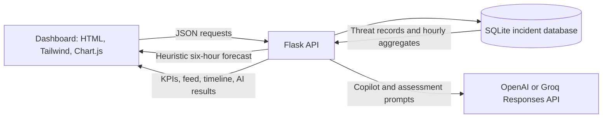

# SentinelPulse AI

A student-ready security operations dashboard with persistent demo incidents, a data-backed activity timeline, a heuristic six-hour threat forecast, AI threat assessment, and an evidence-aware investigation copilot.

## Features

- SQLite incident store with seed data on first run.
- Repeatable threat-event and critical-alert chart, with 24-hour and 7-day ranges.
- Six-hour network threat outlook with an explainable risk index, estimated event volume, leading observed attack type, and confidence based on data coverage.
- Attack simulator, severity filtering, search, mitigation, CSV export, clear feed, and **Reset demo data**.
- Structured AI assessment with risk level, prioritized event IDs, evidence, MITRE IDs, mitigation suggestions, confidence, and data gaps.
- AI copilot with short conversation history, grounded in up to the latest 100 incident records.
- OpenAI or Groq provider selected by server environment variables.
- Demo presentation mode with a synthetic-data badge, a keyboard-accessible guided tour, and one-click sample-data reset.

## Architecture



The database is created at `instance/sentinelpulse.db` and seeded only when empty. Use the dashboard’s **Reset demo data** button to restore the sample incidents. Set `SENTINELPULSE_DB` to use a different database path.

## Run locally

```powershell
pip install -r requirements.txt
$env:OPENAI_API_KEY="your-api-key"
# Optional model override; defaults to gpt-4.1-mini
$env:OPENAI_MODEL="gpt-4.1-mini"
# Optional local-only autoreload for development
$env:FLASK_DEBUG="1"
python app.py
```

Open http://127.0.0.1:5000/.

### Use Groq

Create a key in the [Groq Console](https://console.groq.com/keys), then set the provider and key in the same PowerShell window before starting the app:

```powershell
$env:AI_PROVIDER="groq"
$env:GROQ_API_KEY="your-groq-api-key"
# Optional model override; defaults to openai/gpt-oss-20b
$env:GROQ_MODEL="openai/gpt-oss-20b"
python app.py
```

See [Groq supported models](https://console.groq.com/docs/models) for model IDs available to your account. OpenAI is selected when `AI_PROVIDER` is unset.

## Deploy the AI website

GitHub stores the source code; it does not run this Flask app or provide the Groq key to it. GitHub Pages serves static files, so it cannot host this project's Flask `/api/...` routes. Deploy the repository as a Python web service (for example, a Render Web Service) so the dashboard and API run together on the same origin.

For Render, connect the GitHub repository and use:

- Runtime: **Python 3**
- Build command: `pip install -r requirements.txt`
- Start command: `gunicorn app:app --bind 0.0.0.0:$PORT`

In the service's **Environment** settings, add `AI_PROVIDER=groq`, `GROQ_API_KEY` with a newly generated key, and `GROQ_MODEL=openai/gpt-oss-20b`. Save and deploy the service. Do not put the key in GitHub source files, HTML, or JavaScript. After deploy, open the service URL and check that the header's AI status reports the provider as configured.

## API routes

| Method | Route | Purpose |
| --- | --- | --- |
| GET | `/api/kpis` | KPI totals and health score |
| GET | `/api/threats` | Persisted incident feed |
| DELETE | `/api/threats` | Clear all incident records |
| POST | `/api/demo/reset` | Restore seeded demo records |
| GET | `/api/analytics/activity?hours=24` | Hourly threat and critical-event counts (`hours=24` or `168`) |
| GET | `/api/analytics/forecast` | Six-hour heuristic outlook calculated from recent incident volume and unresolved critical events |
| POST | `/api/simulate` | Add a supported simulated attack |
| POST | `/api/mitigate` | Mark an incident as mitigated |
| POST | `/api/ai/assessment` | Generate a structured assessment from current evidence |
| POST | `/api/copilot` | Ask a conversational question with short history and incident context |
| GET | `/api/copilot/status` | Show configured provider and model (never returns the key) |
| GET | `/api/export` | Download incident CSV |

## Demo checklist

1. Start the app and point out the **Synthetic Data** badge so the audience knows the feed is simulated.
2. Use **Guided tour** for a short walkthrough of the dashboard. Press Escape or Close to exit at any time.
3. Simulate a ransomware or phishing event and watch the chart, feed, and health score update.
4. Review the six-hour outlook and its confidence and event-history drivers.
5. Run **Analyze threats** to get evidence-linked priorities.
6. Mitigate one event and compare the updated status and score.
7. Use **Reset demo data** to restore the original scenario before presenting again.

## Security and deployment

Keep API keys in the server environment; never put them in browser code or commit them. AI requests send up to the latest 100 threat records to the selected provider, so use synthetic records unless you are authorized to share real incident evidence. The built-in Flask server is for local development; use a production WSGI server and disable debug mode before a public deployment.

The forecast is a transparent trend heuristic for demonstration and coursework. It uses the last 24 hours of incident records; its risk index is not a calibrated attack probability and should not be used as a production alerting model. Reliable forecasting needs representative, timestamped network telemetry over a longer period.
